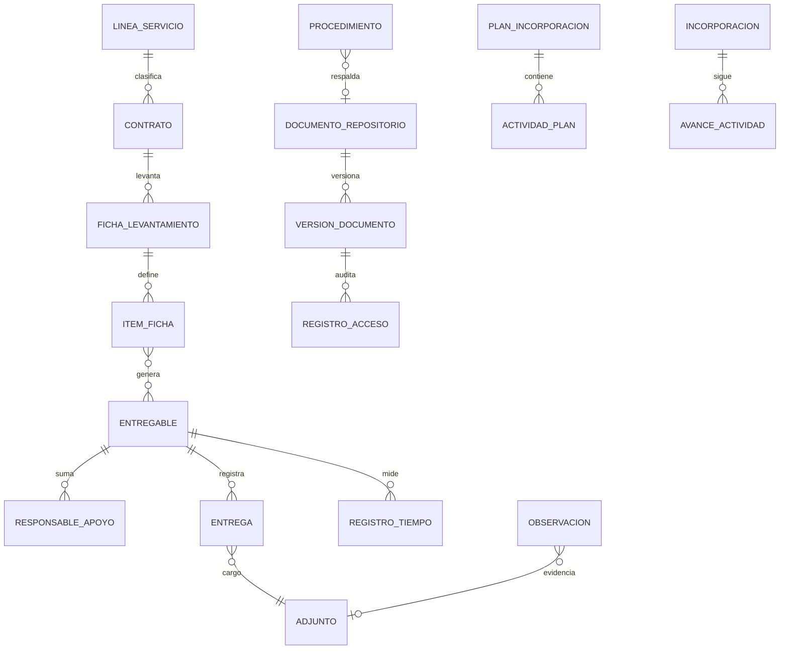
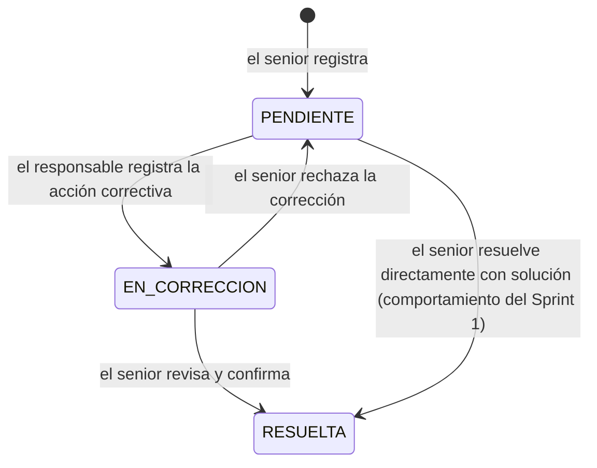

# CertiTrack 360 — SDD del Sprint 2

| | |
|---|---|
| **Proyecto** | CertiTrack 360, plataforma de seguimiento de entregables del área de Proyectos de CERTICOM S.A.C. |
| **Versión** | 2.0-borrador (Sprint 2) |
| **Fecha** | 2026-11-02 |
| **Estado** | Aprobado el 2026-11-02: decisiones resueltas (sección 15) y wireframes aprobados; listo para construir |
| **Se apoya en** | SDD v1.0 (2026-10-05), que sigue vigente en todo lo que este documento no cambia |
| **Fuente del alcance** | Tablero de Trello del equipo: historias con la etiqueta «Sprint 2» (lista *Doing*) y criterios de Sprint 1 aún sin cumplir |

> **Cómo usar este documento.** Es la especificación del Sprint 2. Complementa al SDD v1.0: los identificadores RF-01 a RF-19, las reglas de
> negocio (§10), los permisos (§11) y las restricciones del cliente (RC-01 a RC-09) **siguen vigentes**. Cada requisito nuevo tiene un
> identificador (RF-2x), nace de una historia de usuario (HU-xx), se asigna a un hito (sección 12) y se traza a pruebas (sección 13).
> Regla de oro del sprint: **ningún hito se da por terminado si alguna de las pruebas del Sprint 1 falla** (hoy 445 pruebas en verde).

---

## 1. Resumen

El Sprint 1 entregó el MVP del SDD v1.0: Poka-Yoke, Kanban, calendario con alertas, adjuntos con versiones, accesos por rol, consolidado del
gerente y el asistente de lecciones aprendidas. De las **14 historias** del tablero con la etiqueta «Sprint 2», se construyen **13**; HU-16
queda **fuera de alcance** y HU-15 se construye con la lista de actividades aprobada (decisiones del 2026-11-02, sección 3). Además se **cierran 6
brechas** de historias del Sprint 1 que Trello marca como hechas pero que el código no cumple del todo.

| Grupo | Historias | Qué aporta |
|---|---|---|
| A. Calidad de la revisión | HU-12, HU-17, HU-18, HU-19 | Observaciones con estados y corrección, versiones vigentes y bloqueadas, cargo de recepción y acta de conformidad |
| B. Arranque del servicio | HU-14 (+ HU-06), HU-08 | Ficha de levantamiento del TDR que genera los entregables; gestión y asignación de personal |
| C. Medición | HU-11, HU-13 | Registro de tiempo por etapa; panel de indicadores |
| D. Conocimiento y documentos | HU-07, HU-20, HU-21, HU-10 | Repositorio de plantillas y ejemplos anonimizados; buscador; asistente que también responde sobre procedimientos |
| E. Equipo | HU-15 | Plan de incorporación como lista de actividades por rol (7.12), **aprobado el 2026-11-02** |
| — | ~~HU-16~~ | Bandeja de mensajes para seniors: **fuera de alcance** (SDD v1.0 §3.2 y Anexo A) |

**Fuera del Sprint 2** (etiqueta «Sprint 3» en Trello; no implementar): HU-09, HU-22 a HU-31 (plataforma en servidor de CERTICOM, dashboards
gerenciales, etiquetas dinámicas, OCR, checklists por TDR y de calidad, exportación a PDF/Excel, urgencias fuera de horario, priorización por
tipo de cliente, integración con facturación y reportes automáticos). El diseño de este sprint deja los puntos de apoyo para ellas (sección 14).

---

## 2. Brechas del Sprint 1 que se cierran en este sprint

Comparación criterio por criterio entre las tarjetas «Sprint 1» de Trello y el código actual (`main`, commit `7066134`).

| Historia | Criterio | Situación actual | Qué se hace (requisito) |
|---|---|---|---|
| HU-01 Recepción de solicitudes | Campos obligatorios Cliente, **ID-TDR**, **tipo de servicio**, **fechas de recepción** y entrega | No existen ID-TDR, tipo de servicio ni fecha de recepción; solo hay plazo | RF-20 |
| HU-01 | **Ticket único** por solicitud | El entregable solo tiene su id interno; no hay código visible | RF-20 |
| HU-02 Calendario | Cada entrada identifica cliente, entregable **y responsable** | El evento no muestra al responsable | RF-21 |
| HU-02 | **Filtros** por cliente, fecha y estado | El calendario no tiene filtros | RF-21 |
| HU-03 Alertas | Avisos con **48 y 24 horas** de anticipación | Umbrales por defecto 5, 2 y 0 días: falta el de 24 horas | RF-22 |
| HU-03 | Alerta inmediata cuando el entregable queda **con observación pendiente** (sin marcar en Trello) | Ya se avisa al junior al devolver o al observar, pero no existe el estado visible «con correcciones pendientes» ni el código del entregable en el aviso | RF-22 con RF-26 |
| HU-04 Kanban | Columnas **Por hacer, En proceso, Revisión Senior, Aprobado, Entregado** | Las columnas dicen A realizar, En proceso, Verificación senior, Listo para entrega, Hecho | RF-23 |
| HU-06 Estado previo por cliente | Registro del estado inicial (requerimientos, documentos disponibles y faltantes, formato, fecha límite) que **no se sobrescribe** | **No existe** en el código | RF-30 (se integra con la ficha del TDR, HU-14) |

HU-05 (Poka-Yoke) está completa: los datos quedan con fecha, hora y usuario en el historial de creación.

---

## 3. Conflictos con el SDD v1.0 y cómo se resuelven

El SDD v1.0 (Anexo C, regla 7) manda avisar cuando algo choca con un requisito del cliente. Estos son los choques que trae el tablero.
**Las filas marcadas «Decisión» necesitan confirmación del equipo antes de construir el hito correspondiente**; mientras tanto se usa la propuesta.

| # | Choque | Resolución | Tipo |
|---|---|---|---|
| C1 | **HU-16** (bandeja de mensajes para seniors) contra SDD v1.0 §3.2, que excluye «bandeja de mensajes o chat entre seniors y juniors», y Anexo A, donde el **cliente eliminó** el botón de pedir ayuda al senior | **Resuelta el 2026-11-02: HU-16 queda fuera de alcance.** No se construye ninguna bandeja, consulta ni canal de mensajes. Las dudas siguen cubiertas por el asistente (HU-10) y las notificaciones automáticas | Resuelta |
| C2 | **HU-15** (plan de onboarding) contra SDD v1.0 §3.2, que excluye el «módulo de capacitaciones o programas formativos» | **Aprobada el 2026-11-02:** se construye la **lista de actividades de incorporación** por rol (7.12), con materiales del repositorio y confirmación del responsable; sin cursos, evaluaciones ni puntajes | Resuelta |
| C3 | **HU-17** pide que el estado cambie a «Con correcciones pendientes», pero HU-04 fija **5 columnas** | **Aprobada el 2026-11-02.** No se agrega una sexta columna: «Con correcciones pendientes» es un **subestado calculado** de *En proceso* (hay observaciones abiertas). Se ve como etiqueta en la tarjeta, la lista y el detalle, y se puede filtrar | Resuelta |
| C4 | HU-03 y HU-17 mencionan **correo**; SDD v1.0 §3.2 excluye integraciones externas en el MVP | Solo notificaciones **dentro de la plataforma**. El envío por un servidor de correo **local** queda como mejora futura | Decisión de diseño |
| C5 | **HU-10** (chatbot) contra RC-07 («no es un bot de respuestas fijas») | Se amplía el asistente existente: busca por significado en lecciones **y** en procedimientos aprobados, cita la fuente y no inventa. No hay respuestas programadas | Compatible |
| C6 | **HU-10** criterio 4 (no mostrar información confidencial) contra el asistente actual, que muestra lecciones de entregables que el usuario no ve (sin enlace, pero con el nombre del cliente) | **Resuelta el 2026-11-02: no se anonimizan.** El equipo considera que las lecciones aprendidas no son información confidencial: se mantiene el comportamiento del Sprint 1 (se muestran con cliente; el enlace al entregable solo aparece si el usuario puede verlo). Los procedimientos tampoco se filtran | Resuelta |
| C7 | **HU-14**: la ficha la registra el junior, pero en el SDD v1.0 §11 solo senior, gerente y admin crean entregables (y deben pasar el Poka-Yoke) | **Aprobada el 2026-11-02.** El junior puede **redactar** la ficha (borrador) de sus contratos; un senior del contrato, el gerente o el admin la **confirma**, y solo entonces se generan los entregables, cada uno validado con el mismo Poka-Yoke | Resuelta |
| C8 | **HU-19**: exigir el cargo de recepción para cerrar cambia una regla del Sprint 1 (hoy `LISTO_PARA_ENTREGA → HECHO` no pide nada) | Se agrega la condición. Es el **único cambio de comportamiento deliberado** del sprint; las pruebas y el `seed_demo` del Sprint 1 que cierran entregables se ajustan en el mismo hito (sección 11.3) | Cambio aprobado por la HU |
| C9 | HU-08 pide **uno o más responsables** por entregable; el modelo tiene un junior y un senior | Se conservan `junior_asignado` y `senior_revisor` como **responsables principales** (nada que dependa de ellos se rompe) y se agregan **responsables de apoyo** | Decisión de diseño |

---

## 4. Alcance del Sprint 2 (requisitos funcionales nuevos)

Cada requisito indica su historia, su prioridad dentro del sprint (**M**: imprescindible, **S**: deseable si alcanza el tiempo) y su hito.

| Id | Requisito | Historia | Prioridad | Hito |
|---|---|---|---|---|
| RF-20 | Datos de recepción del entregable: **código único** (`CT-AAAA-NNNNN`), ID-TDR, línea de servicio y fecha de recepción | HU-01 | M | S2-H1 |
| RF-21 | Calendario con responsable en cada evento y filtros por cliente, estado y responsable | HU-02 | M | S2-H1 |
| RF-22 | Alertas a 48 y 24 h (umbrales `5,2,1,0`) y aviso inmediato con código al quedar con correcciones pendientes | HU-03 | M | S2-H1 / S2-H3 |
| RF-23 | Nombres de columnas del Kanban según HU-04 | HU-04 | M | S2-H1 |
| RF-24 | Catálogo de **líneas de servicio** administrable por el gerente (BPO, Custodia, Digitalización, Banca, Estado) | HU-01, HU-07, HU-20 | M | S2-H1 |
| RF-25 | Observaciones con estados `PENDIENTE`, `EN_CORRECCION`, `RESUELTA`, responsable, acción correctiva, fecha de atención y evidencia | HU-12 | M | S2-H3 |
| RF-26 | Sección «Observaciones» del detalle: el senior registra varias a la vez; si el entregable está en revisión, vuelve a *En proceso* con el subestado «Con correcciones pendientes» y se avisa al junior | HU-17 | M | S2-H3 |
| RF-27 | Historial de observaciones consultable y filtrable (cliente, contrato, entregable, responsable, estado, tipo de error) | HU-12 | M | S2-H3 |
| RF-28 | Versiones del entregable: versión **vigente** visible, comentario obligatorio, restaurar una anterior como vigente y versión enviada **bloqueada** al entregar | HU-18 | M | S2-H4 |
| RF-29 | Entregas: cargo de recepción obligatorio (fecha y medio) para pasar a *Entregado*; acta de conformidad con estado; alerta de acta pendiente; historial filtrable; reentregas como nueva versión | HU-19 | M | S2-H4 |
| RF-30 | **Ficha de levantamiento** del contrato: datos del TDR, estado documental inicial congelado, y **generación revisable de entregables** recurrentes | HU-14, HU-06 | M | S2-H5 |
| RF-31 | Personal: listado de colaboradores, responsables de apoyo, reasignación con historial y aviso de conflictos (carga, plazos, ausencias) | HU-08 | M | S2-H6 |
| RF-32 | Registro de tiempo por etapa (recopilación, consolidación, revisión) con cronómetro y ajuste manual justificado | HU-11 | M | S2-H7 |
| RF-33 | Panel de **indicadores** calculados (a tiempo, reproceso, tiempo promedio, observaciones por tipo) con fórmula visible y visibilidad por rol | HU-13 | M | S2-H8 |
| RF-34 | **Repositorio** de plantillas por cliente y de ejemplos anonimizados, con versión vigente e histórico | HU-07, HU-20 | M | S2-H9 |
| RF-35 | Publicación anonimizada con lista de verificación obligatoria y registro de cargas y descargas | HU-20 | M | S2-H9 |
| RF-36 | **Buscador** global (clientes, contratos, entregables, adjuntos y repositorio) con filtros y resultados en menos de 2 s | HU-21 | M | S2-H10 |
| RF-37 | Asistente ampliado a **procedimientos aprobados**, con valoración «¿le sirvió?» e historial propio | HU-10 | S | S2-H11 |
| RF-38 | **Plan de incorporación** por rol con actividades, materiales, avance y confirmación del responsable (aprobado, C2) | HU-15 | S | S2-H12 |
| ~~RF-39~~ | ~~Consultas a seniors~~: **fuera de alcance** (C1). El identificador queda reservado y no se reutiliza | HU-16 | — | — |

Requisitos no funcionales: rigen RNF-01 a RNF-10 del SDD v1.0 sin cambios. Se agregan:

| Id | Requisito |
|---|---|
| RNF-11 | **No regresión:** las rutas, nombres de URL, códigos de estado y modelos del Sprint 1 no se renombran ni se eliminan; todas las migraciones son aditivas y con valores por defecto o de relleno. |
| RNF-12 | **Búsqueda rápida:** el buscador responde en menos de 2 s con el volumen del `seed_demo` multiplicado por 10 (prueba de rendimiento en la suite). |
| RNF-13 | **Sin dependencias nuevas.** Todo se construye con Django, HTMX, SortableJS, FullCalendar, APScheduler y Faker. Los gráficos del panel de indicadores son barras en HTML y CSS. |
| RNF-14 | **Navegación contenida (RC-05):** como máximo 8 entradas en la barra principal; lo demás vive en pestañas de pantallas existentes. |

---

## 5. Arquitectura

Se mantiene el monolito modular de Django con HTMX (SDD v1.0 §8). Cambios:

```
apps/
  cuentas/        + Ausencia; Usuario.puesto
  clientes/       + LineaServicio; Contrato.linea_servicio; pestaña «Personal» en Gestión
  entregables/    + Entregable.codigo, id_tdr, fecha_recepcion; ResponsableApoyo; estados de Observacion;
                    Adjunto.bloqueado; Entrega; RegistroTiempo
  levantamiento/  NUEVA: FichaLevantamiento, ItemFicha (HU-14 y HU-06)
  repositorio/    NUEVA: DocumentoRepositorio, VersionDocumento, RegistroAccesoDocumento (HU-07 y HU-20)
  busqueda/       NUEVA: vista y servicio del buscador, sin modelos (HU-21)
  indicadores/    NUEVA: servicio de cálculo y pantalla, sin modelos (HU-13)
  conocimiento/   + Procedimiento, ConsultaAsistente (HU-10)
  equipo/         NUEVA: PlanIncorporacion, ActividadPlan, Incorporacion, AvanceActividad (HU-15)
  alertas/        Notificacion.entregable pasa a opcional; + Notificacion.enlace y tipos nuevos
  reportes/       sin cambios (fase 3)
```

Principios que se conservan:

- **La visibilidad se aplica en el queryset base** (`apps/entregables/visibilidad.py`). Todo módulo nuevo que muestre entregables, adjuntos,
  observaciones, tiempos o entregas parte de `entregables_visibles(usuario)`. Los filtros nunca amplían la visibilidad.
- **Las reglas viven en servicios**, no en las vistas: `entregables/servicios.py` sigue siendo la única máquina de estados.
- **Archivos**: toda subida reutiliza la validación de `entregables/adjuntos.py` (extensión, tamaño, nombre saneado), que se extrae a una
  función común `validar_archivo` sin cambiar su comportamiento; toda descarga pasa por una vista con verificación de permisos.

---

## 6. Modelo de datos

### 6.1 Cambios en modelos existentes (todos aditivos)

| Modelo | Cambio | Migración y relleno |
|---|---|---|
| `Entregable` | `codigo` (único, `CT-<año de creación>-<id con 5 dígitos>`, prefijo configurable `CODIGO_PREFIJO`) | Se rellena para los existentes; se asigna al crear, dentro de la misma transacción |
| `Entregable` | `id_tdr` (texto, 50) | Vacío en los existentes; **obligatorio en el formulario** para los nuevos |
| `Entregable` | `fecha_recepcion` (fecha) | Se rellena con la fecha de `creado_en`; obligatoria, no futura y no posterior al plazo |
| `Entregable.Estado` | Solo cambian las **etiquetas**: Por hacer, En proceso, Revisión senior, Aprobado, Entregado | Los códigos (`A_REALIZAR`… `HECHO`) no cambian; no hay migración de datos |
| `Contrato` | `linea_servicio` (FK a `LineaServicio`, opcional en base de datos, obligatoria en el formulario) | Los contratos existentes quedan sin línea hasta que el gerente la asigne |
| `Observacion` | `estado` (`PENDIENTE`, `EN_CORRECCION`, `RESUELTA`), `responsable` (FK Usuario), `accion_correctiva` = el campo `solucion` existente, `corregida_por`, `corregida_en`, `revisada_por`, `resuelta_en`, `evidencia` (FK opcional a `Adjunto`) | `estado` se rellena desde `resuelta`; `responsable`, con el junior del entregable. **`resuelta` se conserva** y se sincroniza en `save()` para que lecciones, filtros y consolidado sigan funcionando |
| `Adjunto` | `bloqueado` (bool), `restaurado_desde` (FK opcional a sí mismo); `TipoAdjunto` suma `CARGO_RECEPCION` y `ACTA_CONFORMIDAD` | Falso en los existentes |
| `Notificacion` | `entregable` pasa a **opcional**; se agrega `enlace` (ruta interna); tipos nuevos `CORRECCION`, `ACTA`, `REASIGNACION`, `INCORPORACION`, `FICHA` | La restricción «una alerta por umbral» no cambia |
| `Usuario` | `puesto` (texto opcional, para el plan de incorporación) | Vacío |

### 6.2 Modelos nuevos

**LineaServicio** (`clientes`): `nombre` (único), `activa`. Se crean las cinco del Trello en una migración de datos.

**ResponsableApoyo** (`entregables`): `entregable`, `usuario`, `funcion` (`ELABORACION`, `REVISION`, `APOYO`), `fecha_limite` (opcional),
`asignado_por`, `asignado_en`, `activo`. Un usuario no repite función activa en el mismo entregable.

**Ausencia** (`cuentas`): `usuario`, `desde`, `hasta`, `motivo`. La registran gerente y admin. Solo se usa para avisar conflictos.

**Entrega** (`entregables`): `entregable`, `numero` (1, 2, 3… por entregable), `fecha_entrega`, `medio` (`CORREO`, `MESA_DE_PARTES`,
`FILEDOC`, `PRESENCIAL`, `OTRO`), `cargo` (FK `Adjunto` de tipo `CARGO_RECEPCION`, obligatorio), `version_enviada` (FK `Adjunto`),
`acta_estado` (`PENDIENTE`, `RECIBIDA`, `OBSERVADA`), `acta` (FK `Adjunto` de tipo `ACTA_CONFORMIDAD`, obligatorio si el estado es
`RECIBIDA` u `OBSERVADA`), `acta_actualizada_en`, `registrada_por`, `registrada_en`. Nada se sobrescribe: una reentrega es un registro nuevo.

**RegistroTiempo** (`entregables`): `entregable`, `usuario`, `etapa` (`RECOPILACION`, `CONSOLIDACION`, `REVISION`), `inicio`, `fin`
(vacío mientras corre), `cierra_etapa` (bool), `manual` (bool), `motivo` (obligatorio si es manual), `creado_en`. Restricción: a lo sumo un
registro abierto por usuario. Cliente, responsable y fecha se derivan del entregable y del registro; no se duplican.

**FichaLevantamiento** (`levantamiento`): `contrato` (FK), `id_tdr`, `archivo_tdr` (archivo validado), `requerimientos`, `formatos`,
`frecuencia_reportes`, `penalidades`, `responsable` (FK Usuario), `documentos_disponibles`, `documentos_faltantes`, `formato_esperado`,
`fecha_limite`, `estado` (`BORRADOR`, `CONFIRMADA`), `estado_inicial` (JSON con la foto de todos los campos al confirmar; **nunca se
modifica**), `estado_documental` (`ABIERTO`, `EN_CURSO`, `COMPLETO`), `creada_por`, `confirmada_por`, `confirmada_en`, `actualizada_en`.

**ItemFicha** (`levantamiento`): `ficha`, `nombre`, `plantilla` (FK `PlantillaTDR`), `frecuencia` (`UNICA`, `SEMANAL`, `QUINCENAL`,
`MENSUAL`, `TRIMESTRAL`), `primera_fecha`, `hasta` (por defecto el fin del contrato), `junior`, `senior`, `datos` (JSON con los campos
obligatorios de la plantilla), `entregables_generados` (M2M a `Entregable`).

**DocumentoRepositorio** (`repositorio`): `titulo`, `categoria` (`PLANTILLA_CLIENTE`, `EJEMPLO_ANONIMIZADO`), `cliente` (obligatorio en
plantillas de cliente, vacío en las genéricas y en los anonimizados), `tipo_documento` (`TDR`, `CARTA`, `REPORTE`, `COTIZACION`, `OTRO`),
`linea_servicio` (FK), `activo`, `creado_por`, `creado_en`.

**VersionDocumento** (`repositorio`): `documento`, `numero`, `archivo`, `nombre_original`, `comentario`, `vigente` (exactamente una por
documento), `subido_por`, `subido_en`, `verificacion_anonimizacion` (JSON: ítems confirmados, quién y cuándo; obligatorio en anonimizados).
Los archivos anonimizados se guardan en una carpeta separada de `MEDIA_ROOT` (`repositorio/anonimizados/`) de los de clientes
(`repositorio/clientes/`).

**RegistroAccesoDocumento** (`repositorio`): `version`, `usuario`, `accion` (`CARGA`, `DESCARGA`, `RESTAURACION`), `fecha`.

**Procedimiento** (`conocimiento`): `titulo`, `contenido` (texto), `linea_servicio` (opcional), `documento` (FK opcional al repositorio),
`aprobado_por`, `aprobado_en`, `vigente`, `embedding`, `embedding_modelo`. Se indexa con el mismo comando `indexar_lecciones`.

**ConsultaAsistente** (`conocimiento`): `usuario`, `pregunta`, `respuesta`, `fuentes` (JSON con ids citados), `util` (sí/no/vacío),
`creada_en`. Cada usuario ve solo las suyas.

**PlanIncorporacion**, **ActividadPlan**, **Incorporacion**, **AvanceActividad** (`equipo`): plan por rol (y
puesto opcional); actividad con orden, semana, título, descripción, recurso (FK opcional a `DocumentoRepositorio` o a `Procedimiento`) y rol
responsable; incorporación con ingresante, responsable, fecha de inicio, confirmada por y cuándo; avance por actividad con estado
(`PENDIENTE`, `EN_CURSO`, `COMPLETADA`) y fecha.

### 6.3 Diagrama entidad-relación (solo lo nuevo)



---

## 7. Reglas de negocio

### 7.1 Flujo de estados (actualiza SDD v1.0 §10.1)

Los códigos y las transiciones existentes **no cambian**; cambian las etiquetas, se agregan condiciones y una sola transición nueva
(la reapertura, última fila).

| Transición | Etiquetas | Quién | Condiciones |
|---|---|---|---|
| `A_REALIZAR → EN_PROCESO` | Por hacer → En proceso | Junior asignado o de apoyo (elaboración), senior, gerente, admin | — |
| `EN_PROCESO → VERIFICACION_SENIOR` | En proceso → Revisión senior | Igual | Datos y adjuntos requeridos (Sprint 1). **Nuevo:** no quedan observaciones en `PENDIENTE` (las que están `EN_CORRECCION` sí pueden ir a revisión) |
| `VERIFICACION_SENIOR → LISTO_PARA_ENTREGA` | Revisión senior → Aprobado | Senior revisor, gerente, admin | **Nuevo:** no quedan observaciones abiertas (`PENDIENTE` o `EN_CORRECCION`) |
| `VERIFICACION_SENIOR → EN_PROCESO` | Revisión senior → En proceso | Senior revisor, gerente, admin | Exige al menos una observación (Sprint 1) |
| `LISTO_PARA_ENTREGA → HECHO` | Aprobado → Entregado | Senior, gerente, admin | **Nuevo (RF-29):** debe registrarse la entrega con cargo de recepción, fecha y medio; la versión final vigente queda bloqueada |
| `HECHO → EN_PROCESO` **(nueva)** | Entregado → En proceso | Senior del entregable, gerente, admin | Solo si la última entrega tiene el acta `OBSERVADA`; exige al menos una observación (7.4) |

**Subestado «Con correcciones pendientes» (RF-26, C3):** se calcula, no se guarda. Aplica cuando el estado es `EN_PROCESO` y el entregable
tiene observaciones abiertas. Se muestra como etiqueta de texto (no solo color) en tarjeta, lista, detalle y calendario, y se agrega como
opción del filtro de estado.

### 7.2 Observaciones (RF-25 a RF-27)



- Registrar: senior del entregable, gerente o admin (como en el Sprint 1). Se pueden registrar varias en un mismo envío.
- Si el entregable está en `VERIFICACION_SENIOR`, registrar observaciones **lo devuelve a `EN_PROCESO`** en la misma transacción, usando
  `servicios.mover` (no hay un segundo camino para cambiar de estado).
- Registrar la acción correctiva: el responsable de la observación (por defecto el junior asignado) o un senior; exige texto y admite
  vincular como evidencia una versión de adjunto del mismo entregable.
- `RESUELTA` exige acción correctiva y queda registrado quién la revisó y cuándo (HU-12 criterio 4). La ruta del Sprint 1
  `/observaciones/<id>/resolver/` sigue funcionando igual.
- Avisos: al registrar, al junior asignado (tipo `OBSERVACION`, con el código del entregable); al registrar la corrección, al senior revisor
  (tipo `CORRECCION`); al rechazar, al responsable.
- Las lecciones aprendidas se siguen generando a partir de observaciones `RESUELTA` con solución, al cerrar el entregable.

### 7.3 Versiones (RF-28)

- La versión **vigente** de cada tipo de adjunto es la de número más alto que no fue eliminada. El detalle la destaca con la etiqueta
  «Vigente» y el resto queda en «Versiones anteriores».
- **Comentario obligatorio** al subir (formulario); en la base de datos sigue siendo opcional para no romper los datos existentes.
- **Restaurar** una versión anterior crea una **nueva versión** que copia el archivo, con `restaurado_desde` y el comentario «Restaurada
  desde la vN». Nunca se reescribe una versión. Pueden restaurar el senior del entregable, el gerente y el admin. Queda en el historial.
- Al pasar a `HECHO`, la versión enviada (la vigente de `VERSION_FINAL`, o la que se indique en la entrega) se marca `bloqueado`: no se
  elimina ni siquiera por el gerente; la vista de eliminación responde 403 con el motivo.

### 7.4 Entregas y actas (RF-29)

- En el tablero, soltar una tarjeta de «Aprobado» en «Entregado» no la mueve: abre el formulario de entrega (el arrastre no puede adjuntar
  el cargo).
- El botón «Marcar como entregado» abre el formulario de entrega: fecha (no futura), medio, archivo del cargo (obligatorio) y versión
  enviada. Al guardar, en una transacción: crea el `Adjunto` del cargo, la `Entrega` (acta `PENDIENTE`), bloquea la versión y mueve a
  `HECHO` con `servicios.mover`.
- El acta se registra después desde el detalle: estado `RECIBIDA` u `OBSERVADA` con su archivo. Si queda `OBSERVADA`, el gerente o el
  senior pueden reabrir el trabajo como una **reentrega**: queda en el historial y la siguiente entrega tiene `numero + 1`.
  **Reapertura (aprobada el 2026-11-02):** se agrega la transición `HECHO → EN_PROCESO`, permitida solo al senior del entregable, al
  gerente y al admin, solo cuando la última entrega tiene el acta `OBSERVADA`, y exigiendo al menos una observación (igual que una
  devolución). Las versiones bloqueadas siguen bloqueadas; la corrección se sube como versión nueva. Queda en el historial.
- Tarea programada diaria (la misma de las alertas): si el acta sigue `PENDIENTE` más de `ACTA_DIAS_PENDIENTE` días (por defecto 5), avisa
  al junior asignado y al senior revisor **una sola vez** por entrega.
- Historial `/entregas/`: filtros por cliente, contrato, periodo (fecha de entrega) y estado del acta, sobre los entregables visibles.

### 7.5 Ficha de levantamiento y generación de entregables (RF-30)

1. Crear la ficha: se elige un contrato activo visible y se completan los datos. Validación de obligatorios (contrato, ID-TDR, archivo del
   TDR, requerimientos, al menos un ítem, responsable): el mensaje dice exactamente qué falta, igual que el Poka-Yoke.
2. Cada ítem define plantilla, frecuencia, primera fecha, fecha final, junior y senior, y los **datos obligatorios** de la plantilla (se
   completan una vez por ítem).
3. «Vista previa»: muestra la lista de entregables que se crearían (título con periodo, p. ej. «Reporte mensual — 2026-12», y plazo). Se
   descartan los plazos pasados con un aviso. El usuario puede corregir antes de confirmar (HU-14 criterio 5).
4. Si quien redacta es un junior, el botón «Pedir confirmación» avisa al senior responsable del contrato (notificación sin entregable,
   con enlace a la ficha).
   «Confirmar» (senior del contrato, gerente o admin, C7): crea los entregables con el **mismo servicio** que la pantalla «Nuevo
   entregable» (Poka-Yoke, historial de creación, aviso de asignación, código único), hereda el ID-TDR y congela `estado_inicial`.
   Límite de seguridad: `FICHA_MAX_ENTREGABLES` (por defecto 60) por confirmación.
5. Los entregables generados aparecen en el tablero y el calendario porque son entregables normales.
6. **Estado documental (HU-06):** después de confirmar, se pueden actualizar los documentos disponibles y faltantes y el estado
   documental, pero la sección «Estado inicial» muestra siempre la foto congelada. Listado con filtros por cliente, contrato y estado.

### 7.6 Personal y asignación (RF-31)

- Pestaña «Personal» en Gestión (gerente y admin): colaboradores con rol, puesto, entregables activos, ausencias próximas.
- Visibilidad: un **responsable de apoyo activo** ve el entregable como si fuera su junior (se agrega una condición a
  `entregables_visibles`); no puede aprobar ni devolver salvo que sea senior del entregable.
- Reasignar al junior o al senior principal: gerente, admin o senior responsable del contrato. Queda en el historial («Reasignado de X a
  Y») y avisa a quien entra y a quien sale.
- **Conflictos** antes de confirmar (aviso, no bloqueo): más de `CARGA_MAXIMA_ACTIVOS` entregables activos (por defecto 8), otro
  entregable con plazo en los mismos 2 días, o ausencia registrada que cubre el plazo. La persona confirma con un segundo clic.

### 7.7 Registro de tiempo (RF-32)

- Desde el detalle: «Iniciar» (elige etapa), «Pausar» (cierra el registro abierto) y «Finalizar etapa» (lo cierra con `cierra_etapa`).
  Iniciar otro cuando hay uno abierto lo pausa primero, con aviso.
- Solo registra tiempo quien está asignado al entregable (principal o de apoyo) o un senior del entregable.
- Ajuste manual: inicio, fin y motivo obligatorio; `fin > inicio`, no futuro y máximo 12 h por registro; queda marcado como «Manual».
- El detalle muestra el acumulado por etapa y el total. Listado `/tiempos/` con filtros por cliente, etapa, responsable y fechas. Junior:
  solo sus registros; senior: los de sus entregables; gerente y admin: todos.

### 7.8 Indicadores (RF-33)

Se calculan en el momento sobre los entregables visibles (Junior: los suyos; Senior: los de sus contratos; Gerente y Admin: todos):

| Indicador | Fórmula mostrada en pantalla |
|---|---|
| % entregados a tiempo | Entregables con entrega registrada en una fecha ≤ plazo ÷ entregables entregados en el periodo |
| % con reproceso | Entregables con al menos una devolución (`VERIFICACION_SENIOR → EN_PROCESO` en el historial) ÷ entregables que pasaron por revisión |
| Tiempo promedio de elaboración por plantilla | Promedio de días entre la creación y la entrega; y, si hay registros de tiempo, horas registradas promedio |
| Observaciones por tipo de error | Conteo por `tipo_error` en el periodo |

Filtros: periodo, cliente, plantilla (tipo de entregable) y responsable. Sin ingreso manual. Para los entregables cerrados antes del Sprint 2
(sin `Entrega`), la fecha de entrega es la del paso a `HECHO` en el historial. El panel no reemplaza al consolidado (RF-16), que sigue
siendo exclusivo del gerente y el admin; los gráficos de gestión son HU-22 (Sprint 3).

### 7.9 Repositorio (RF-34, RF-35)

| Acción | Junior | Senior | Gerente / Admin |
|---|---|---|---|
| Ver y descargar plantillas genéricas y anonimizadas | Sí | Sí | Sí |
| Ver y descargar plantillas de un cliente | Si está asignado a un contrato activo del cliente | Si es responsable o revisor en un contrato del cliente | Sí |
| Cargar plantilla de cliente o nueva versión | No | Sí, de sus clientes | Sí |
| Publicar ejemplo anonimizado | No | Sí | Sí |
| Dar de baja (lógica) | No | No | Sí |

- Publicar un anonimizado exige marcar los cuatro ítems de verificación (nombres de clientes, montos, números de contrato y datos personales
  eliminados). Sin ellos el servidor rechaza la carga. Llevan la etiqueta «Anonimizado».
- Una nueva carga crea una versión vigente y deja la anterior como histórico; se puede restaurar como en 7.3.
- Cada carga, descarga y restauración queda en `RegistroAccesoDocumento`; la pantalla del documento muestra ese registro a gerente y admin.
- Búsqueda y filtros por cliente, tipo de documento, línea de servicio y categoría.
- Las `PlantillaTDR` (definición de campos) **no cambian**; el repositorio guarda los archivos de formato. En el formulario de la
  plantilla se puede enlazar el documento del repositorio que sirve de formato (opcional; lo usará la exportación del Sprint 3).

### 7.10 Buscador (RF-36)

- Caja de búsqueda en la barra superior y página `/buscar/` con resultados agrupados: entregables (código, título, ID-TDR), contratos
  (número), clientes, adjuntos (nombre del archivo) y documentos del repositorio (título).
- Filtros: fechas, tipo de documento, estado y cliente. Búsqueda insensible a mayúsculas y tildes; mínimo 2 caracteres; resultados
  limitados (`BUSCADOR_LIMITE`, 20 por grupo) y actualizados con HTMX mientras se escribe (espera de 300 ms).
- **Visibilidad:** cada grupo parte de su queryset visible. Un junior encuentra solo sus entregables y los adjuntos de ellos, los contratos
  donde está asignado y el repositorio que puede ver. No se busca dentro del contenido de los archivos.
- Desde el resultado se abre el detalle o se descarga mediante las vistas controladas ya existentes.

### 7.11 Asistente ampliado (RF-37)

- Fuentes: lecciones aprendidas (Sprint 1) y procedimientos vigentes. El gerente o el admin cargan y aprueban los procedimientos.
- La respuesta cita la fuente (procedimiento o caso). Si no hay fuentes suficientes, lo dice y sugiere escalar la consulta al senior del
  contrato por los canales habituales (la plataforma no tiene bandeja de mensajes, C1).
- Lecciones de otros clientes (C6, resuelta): se muestran con su cliente, como en el Sprint 1; el enlace al entregable de origen solo
  aparece si el usuario puede verlo.
- Debajo de cada respuesta: «¿Le sirvió? Sí / No». La pantalla lista las consultas anteriores del usuario para volver a verlas.
- Degradación (RNF-09) igual que en el Sprint 1.

### 7.12 Plan de incorporación (RF-38) — aprobado el 2026-11-02 (C2)

**Por qué no es un programa formativo:** no hay cursos, clases, exámenes, notas ni puntajes. Es una lista de tareas de la operación diaria
que el ingresante hace con las herramientas reales de la plataforma, para que deje de depender de preguntar a los seniors (problema 3 del
SDD v1.0 §2). Todos los materiales ya existen en otros módulos (repositorio, procedimientos, asistente, fichas).

**Funcionamiento:**
- El gerente define planes por rol (y puesto opcional) con actividades ordenadas por semana: descripción, recurso (documento vigente del
  repositorio, procedimiento o pantalla de la plataforma) y rol responsable.
- Al asignar un plan a un ingresante se crean sus avances en `PENDIENTE`. El ingresante ve la tarjeta «Mi incorporación» en el inicio, con
  pendientes y completadas, y marca su avance. Si un recurso tiene una versión nueva, el enlace apunta siempre a la vigente.
- El responsable (senior asignado) ve el progreso y confirma la finalización cuando todas las actividades están completadas.

**Plan «Asistente junior de Proyectos» (2 semanas), carga inicial del `seed_demo`:**

| # | Semana | Actividad | Recurso | Responsable | Cómo se comprueba |
|---|---|---|---|---|---|
| 1 | 1 | Recorrer CertiTrack 360: inicio, tablero, calendario, avisos y buscador | Procedimiento «Guía rápida de CertiTrack 360» | Senior asignado | El ingresante la marca como completada |
| 2 | 1 | Leer la política de confidencialidad y el uso de documentos anonimizados (NDA) | Procedimiento «Confidencialidad y datos de clientes» | Gerente | Marcada por el ingresante |
| 3 | 1 | Conocer el flujo de un entregable: estados, Poka-Yoke, adjuntos requeridos y observaciones | Procedimiento «Flujo de un entregable» | Senior asignado | Marcada por el ingresante |
| 4 | 1 | Revisar las fichas de levantamiento de los contratos asignados (requerimientos, frecuencia, penalidades) | Fichas de levantamiento de sus contratos | Senior asignado | Marcada por el ingresante |
| 5 | 1 | Revisar las plantillas vigentes de los clientes asignados | Repositorio › plantillas del cliente | Senior asignado | Marcada por el ingresante |
| 6 | 1 | Revisar dos ejemplos anonimizados de entregables aprobados | Repositorio › ejemplos anonimizados | Senior asignado | Marcada por el ingresante |
| 7 | 1 | Consultar en el asistente los errores más frecuentes de sus clientes | Asistente (lecciones aprendidas) | Senior asignado | Marcada por el ingresante |
| 8 | 2 | Elaborar un entregable real como responsable de apoyo, acompañado por el junior titular, hasta Revisión senior | Entregable asignado (responsable de apoyo, RF-31) | Senior asignado | El entregable llega a Revisión senior |
| 9 | 2 | Registrar el tiempo por etapa de ese entregable | Sección «Tiempo» del detalle (RF-32) | Senior asignado | Hay registros de tiempo suyos |
| 10 | 2 | Atender una observación: registrar la acción correctiva y la evidencia | Sección «Observaciones» del detalle (RF-25) | Senior asignado | Una observación suya pasa a «En corrección» |
| 11 | 2 | Registrar una entrega con cargo de recepción y el acta de conformidad | Formulario «Marcar como entregado» (RF-29) | Senior asignado | La entrega queda registrada |
| 12 | 2 | Reunión de cierre: dudas pendientes y confirmación del plan | — | Senior asignado y gerente | El responsable confirma la finalización |

**Plan «Senior de Proyectos» (1 semana):** actividades 1, 2, 4 y 5 de la lista anterior, más «Revisar el panel de
indicadores de sus contratos» (RF-33), «Confirmar una ficha de levantamiento de prueba» (RF-30) y «Confirmar o rechazar una corrección»
(RF-25).

Todas las actividades las marca el ingresante (comprobación manual); el responsable revisa antes de confirmar la finalización. La
columna «Cómo se comprueba» orienta al responsable. *Decisión de diseño:* la marca automática al detectar la acción queda como mejora.

---

## 8. Roles y permisos (se suma a SDD v1.0 §11)

| Acción | Junior | Senior | Gerente | Admin |
|---|---|---|---|---|
| Registrar acción correctiva de su observación | Sí | Sí | Sí | Sí |
| Confirmar o rechazar una corrección | No | Sí (sus entregables) | Sí | Sí |
| Restaurar una versión | No | Sí (sus entregables) | Sí | Sí |
| Registrar entrega y acta | No | Sí (sus entregables) | Sí | Sí |
| Redactar ficha de levantamiento | Sí (contratos asignados) | Sí | Sí | Sí |
| Confirmar ficha y generar entregables | No | Sí (contratos a su cargo) | Sí | Sí |
| Ver personal y ausencias | No | Solo carga de su equipo | Sí | Sí |
| Reasignar responsables | No | Sí (contratos a su cargo) | Sí | Sí |
| Registrar tiempo | Sí (asignado) | Sí | Sí | Sí |
| Ver indicadores | Los suyos | Sus contratos | Todos | Todos |
| Usar el buscador | Según visibilidad | Según visibilidad | Sí | Sí |
| Cargar procedimientos | No | No | Sí | Sí |
| Gestionar planes de incorporación | No | No | Sí | Sí |
| Marcar su avance de incorporación | Sí | Sí | — | — |

Lo que el usuario no puede ver responde 404; lo que ve pero no puede hacer, 403 (igual que en el Sprint 1).

---

## 9. Interfaz

### 9.1 Wireframes primero

Igual que en el Sprint 1 (H0.5), **antes de construir se agregan wireframes de baja fidelidad** en `docs/wireframes/` y el equipo los
aprueba. Están en `docs/wireframes/sprint-2.html` (archivos `s2-*.html`), con su registro de aprobación. Pantallas nuevas o modificadas:

| Pantalla | Tipo | Historias |
|---|---|---|
| Detalle de entregable: secciones Observaciones (con estados), Versiones (vigente y restaurar), Entregas y acta, Tiempo, Responsables | Modificada | HU-12, 17, 18, 19, 11, 08 |
| Nuevo entregable: ID-TDR, fecha de recepción y línea de servicio | Modificada | HU-01 |
| Tablero y lista: etiquetas nuevas de columnas, código y subestado | Modificada | HU-04, 01, 17 |
| Calendario con filtros | Modificada | HU-02 |
| Fichas de levantamiento (lista, edición, vista previa y estado inicial) | Nueva | HU-14, 06 |
| Gestión › Personal y Líneas de servicio | Nueva pestaña | HU-08, 01 |
| Historial de observaciones · Historial de entregas · Tiempos | Nuevas (pestañas de «Entregables») | HU-12, 19, 11 |
| Indicadores | Nueva | HU-13 |
| Repositorio (lista, documento con versiones, publicar anonimizado) | Nueva | HU-07, 20 |
| Buscador (caja en la barra y página de resultados) | Nueva | HU-21 |
| Asistente con fuentes, valoración e historial | Modificada | HU-10 |
| Mi incorporación · Planes de incorporación | Nueva | HU-15 |

### 9.2 Navegación (RNF-14)

Barra principal: **Inicio · Tablero · Calendario · Entregables · Repositorio · Indicadores · Asistente**, y para gerente y admin
**Consolidado · Gestión**. La caja de búsqueda y «Avisos» quedan a la derecha. Fichas de levantamiento viven en
Gestión y en el detalle del contrato; los procedimientos del asistente se consultan en Repositorio › Procedimientos (la ruta
`/procedimientos/` es la de carga y aprobación); historial de observaciones, entregas y tiempos son pestañas de «Entregables»; «Mi incorporación» es
una tarjeta del inicio.

---

## 10. Rutas nuevas

Las rutas del SDD v1.0 §14 se conservan sin cambios.

| Ruta | Método | Descripción |
|---|---|---|
| `/observaciones/` | GET | Historial filtrable |
| `/observaciones/<id>/corregir/` | POST | Registrar acción correctiva |
| `/observaciones/<id>/revisar/` | POST | Confirmar o rechazar la corrección |
| `/adjuntos/<id>/restaurar/` | POST | Restaurar como vigente |
| `/entregables/<id>/entregar/` | GET, POST | Registrar entrega con cargo (pasa a Entregado) |
| `/entregas/` | GET | Historial de entregas |
| `/entregas/<id>/acta/` | POST | Registrar o actualizar el acta |
| `/entregables/<id>/tiempo/` | POST (HTMX) | Iniciar, pausar, finalizar o ajuste manual |
| `/tiempos/` | GET | Registros de tiempo filtrables |
| `/entregables/<id>/responsables/` | POST | Reasignar o sumar responsables (con aviso de conflictos) |
| `/fichas/`, `/fichas/nueva/`, `/fichas/<id>/` | GET, POST | Fichas de levantamiento |
| `/fichas/<id>/vista-previa/`, `/fichas/<id>/confirmar/` | POST | Generación de entregables |
| `/personal/`, `/lineas-servicio/` | GET, POST | Pestañas de Gestión |
| `/indicadores/` | GET | Panel de indicadores |
| `/repositorio/`, `/repositorio/nuevo/`, `/repositorio/<id>/` | GET, POST | Repositorio |
| `/repositorio/versiones/<id>/descargar/` | GET | Descarga controlada y registrada |
| `/buscar/` | GET (HTMX) | Buscador |
| `/asistente/valorar/<id>/` | POST | «¿Le sirvió?» |
| `/procedimientos/` | GET, POST | Procedimientos (gerente y admin) |
| `/incorporacion/`, `/incorporacion/planes/` | GET, POST | Plan de incorporación |

### 10.1 Configuración nueva (`.env.example`)

| Variable | Por defecto | Uso |
|---|---|---|
| `ALERT_THRESHOLDS_DAYS` | `5,2,1,0` (antes `5,2,0`) | Suma el aviso de 24 h. La urgencia «Crítico» pasa a usar el **segundo umbral mayor** (2), así que su significado no cambia |
| `CODIGO_PREFIJO` | `CT` | Prefijo del código del entregable |
| `ACTA_DIAS_PENDIENTE` | `5` | Días para avisar que el acta sigue pendiente |
| `CARGA_MAXIMA_ACTIVOS` | `8` | Umbral de sobrecarga al asignar |
| `FICHA_MAX_ENTREGABLES` | `60` | Máximo de entregables por confirmación de ficha |
| `BUSCADOR_LIMITE` | `20` | Resultados por grupo |

---

## 11. Compatibilidad con el Sprint 1 (no regresión)

### 11.1 Lo que no se toca

- Códigos de estado, transiciones existentes, nombres de URL (`name=`) y rutas del Sprint 1.
- `servicios.mover` sigue siendo la única puerta para cambiar de estado; las condiciones nuevas se agregan dentro de él.
- `entregables_visibles` solo **suma** una condición (responsables de apoyo); los casos actuales siguen igual.
- `Observacion.resuelta`, `HistorialEstado`, `Adjunto.version` y la restricción de versión única.
- El asistente sigue funcionando sin Ollama; el comando `indexar_lecciones` conserva su nombre.

### 11.2 Migraciones

Todas aditivas, una por app y por hito, con relleno de datos donde corresponde (código, fecha de recepción, estado de observaciones, líneas de
servicio). Cada migración de datos tiene su reversa. Se prueba `migrate` sobre una copia de la base del `seed_demo` del Sprint 1 antes de
cada commit.

### 11.3 Cambios deliberados que exigen ajustar pruebas existentes

| Cambio | Pruebas o archivos del Sprint 1 afectados | Ajuste |
|---|---|---|
| Etiquetas de estados (RF-23) | Pruebas que comparan el texto «Hecho», «A realizar», «Verificación senior», etc., plantillas y wireframes | Comparar contra `Entregable.Estado.X.label`, no contra el texto fijo |
| Cargo obligatorio para `HECHO` (RF-29) | Pruebas que llaman `mover(..., HECHO)`, `seed_demo` (7 entregables en Hecho), `test_seed.py`, `apps/conocimiento/tests.py` | Ayudante `entregar(entregable, usuario)` en `apps/entregables/testing.py` que crea el cargo y llama al servicio de entrega; el seed crea cargo y acta para los entregables cerrados |
| Sin observaciones pendientes para pasar a revisión o aprobar (7.1) | Pruebas de flujo que devuelven y vuelven a enviar sin resolver | Resolver o marcar la corrección en esas pruebas; agregar pruebas del rechazo nuevo |
| Transición nueva `HECHO → EN_PROCESO` (reapertura, 7.4) | Pruebas que comprueban que salir de `HECHO` siempre se rechaza | Mantenerlas para el caso sin acta observada (sigue rechazado) y agregar el caso permitido |
| Comentario obligatorio al subir (formulario) | Pruebas de subida sin comentario | Enviar comentario; la función de servicio `subir()` lo sigue aceptando vacío para el seed |
| Navegación nueva | `apps/cuentas/test_interfaz.py` (barra por rol) | Actualizar la lista esperada por rol |

Cualquier otro cambio en una prueba del Sprint 1 es una señal de regresión y se revisa antes de seguir.

---

## 12. Plan de implementación por hitos

Ejecutar en orden. Al terminar cada hito: correr **todas** las pruebas, actualizar `docs/trazabilidad.md` y hacer un commit. 

| Hito | Contenido | Criterio de aceptación |
|---|---|---|
| **S2-H0 — Wireframes y decisiones** | Wireframes de la sección 9.1; registro de decisiones C1 a C9 | El equipo aprueba los wireframes y responde las decisiones |
| **S2-H1 — Cierre del Sprint 1** | RF-20 a RF-24: código, ID-TDR, fecha de recepción, líneas de servicio, etiquetas del Kanban, calendario con responsable y filtros, umbral de 24 h | Las brechas de la sección 2 quedan cubiertas con pruebas; las 445 pruebas siguen pasando (con los ajustes de 11.3) |
| **S2-H2 — Base común** | `Notificacion.entregable` opcional y `enlace`; validación de archivos reutilizable; ayudantes de prueba (`entregar`) | Las notificaciones sin entregable se muestran y enlazan bien; ninguna prueba del Sprint 1 cambia |
| **S2-H3 — Observaciones y revisiones** | RF-25 a RF-27 y el aviso de RF-22 | Una observación no queda resuelta sin acción correctiva; observar en revisión devuelve el entregable y avisa al junior con el código |
| **S2-H4 — Versiones y entregas** | RF-28, RF-29 y la alerta de acta | No se pasa a Entregado sin cargo; la versión enviada no se puede eliminar; restaurar crea una versión nueva; una sola alerta por acta pendiente |
| **S2-H5 — Ficha de levantamiento** | RF-30 (HU-14 y HU-06) | Una ficha mensual de 3 meses genera 3 entregables visibles en tablero y calendario; la foto inicial no cambia al editar; un junior no puede confirmar |
| **S2-H6 — Personal y asignación** | RF-31 | Un responsable de apoyo ve el entregable y no puede aprobarlo; la reasignación queda en el historial; los conflictos se avisan |
| **S2-H7 — Tiempo por etapa** | RF-32 | Un usuario no tiene dos registros abiertos; el ajuste manual exige motivo; cada rol ve solo lo suyo |
| **S2-H8 — Indicadores** | RF-33 | Las cifras coinciden con datos preparados en las pruebas; cada indicador muestra su fórmula; un junior solo ve los suyos |
| **S2-H9 — Repositorio** | RF-34, RF-35 | Un junior no descarga plantillas de un cliente ajeno; sin la verificación no se publica un anonimizado; cargas y descargas quedan registradas |
| **S2-H10 — Buscador** | RF-36 | Un junior no encuentra entregables ajenos; responde en menos de 2 s con 10 veces el volumen del seed |
| **S2-H11 — Asistente ampliado** | RF-37 | Cita un procedimiento ficticio; una lección de un entregable no visible se muestra sin enlace; guarda la valoración |
| **S2-H12 — Incorporación** | RF-38 | El ingresante ve pendientes y completadas; solo el responsable confirma la finalización |
| **S2-H13 — Datos, pruebas y documentación** | `seed_demo` ampliado (sección 12.1), guion de demostración del Sprint 2 en el README, trazabilidad, recorrido en navegador | Con la base vacía, `seed_demo --reset` deja todo demostrable y todas las pruebas pasan |

### 12.1 Datos simulados que se agregan al `seed_demo`

Siempre ficticios (RC-03): las cinco líneas de servicio asignadas a los contratos; código, ID-TDR y fecha de recepción en todos los
entregables; observaciones en los tres estados; entregas con cargo y actas en los tres estados (una pendiente vencida para mostrar la alerta);
dos fichas de levantamiento (una en borrador y otra confirmada con entregables generados); responsables de apoyo y una ausencia; registros de
tiempo de las tres etapas (alguno manual); 8 a 10 documentos del repositorio (plantillas de cliente con dos versiones y ejemplos
anonimizados); 5 procedimientos (entre ellos los tres que cita la lista de 7.12); los dos planes de 7.12 y una incorporación en curso.

---

## 13. Estrategia de pruebas y trazabilidad

Se mantienen los niveles del SDD v1.0 §17. Casos clave nuevos (se numeran a continuación de los 12 del Sprint 1):

| # | Caso | Requisito |
|---|---|---|
| 13 | Todo entregable nuevo tiene código único; el formulario rechaza la falta de ID-TDR o una fecha de recepción futura | RF-20 |
| 14 | El calendario filtra por cliente y estado sin ampliar la visibilidad y muestra al responsable | RF-21 |
| 15 | Con umbrales `5,2,1,0` se genera el aviso de 24 h una sola vez y la urgencia «Crítico» sigue empezando a 2 días | RF-22 |
| 16 | Las columnas muestran las etiquetas de HU-04 y los códigos guardados no cambian | RF-23 |
| 17 | Observar en revisión devuelve a En proceso, muestra «Con correcciones pendientes» y avisa al junior | RF-26 |
| 18 | No se resuelve una observación sin acción correctiva; no se aprueba con observaciones abiertas | RF-25 |
| 19 | No se pasa a Entregado sin cargo; la versión enviada queda bloqueada; restaurar crea versión nueva | RF-28, RF-29 |
| 20 | El acta pendiente más allá del plazo genera un solo aviso al junior y al senior | RF-29 |
| 21 | La ficha genera los entregables esperados, descarta plazos pasados, valida obligatorios y conserva la foto inicial | RF-30 |
| 21b | Reabrir un entregado solo es posible con el acta observada, por senior, gerente o admin, y exige observación | RF-29 |
| 22 | Un responsable de apoyo ve el entregable pero no puede aprobar; reasignar deja historial y avisos | RF-31 |
| 23 | Un usuario no puede tener dos registros de tiempo abiertos; el ajuste manual exige motivo | RF-32 |
| 24 | Los indicadores coinciden con un conjunto de datos conocido y respetan la visibilidad por rol | RF-33 |
| 25 | Un junior no ve ni descarga plantillas de clientes ajenos; un anonimizado sin verificación se rechaza | RF-34, RF-35 |
| 26 | El buscador nunca devuelve resultados fuera de la visibilidad y responde en menos de 2 s | RF-36 |
| 27 | El asistente cita un procedimiento; la lección de un entregable no visible no tiene enlace; la valoración se guarda | RF-37 |
| 28 | Solo el responsable confirma el fin del plan de incorporación, y solo con todas las actividades completadas | RF-38 |
| 29 | **Regresión:** las pruebas del Sprint 1 pasan y `migrate` funciona sobre una base del Sprint 1 | RNF-11 |
| 30 | **Fuera de alcance respetado:** no existe ninguna ruta, modelo ni enlace de bandeja de mensajes o consultas entre personas | C1 |

| Requisito | Hito | Casos |
|---|---|---|
| RF-20, RF-21, RF-22, RF-23, RF-24 | S2-H1 (RF-22 se completa en S2-H3) | 13 a 16 |
| RF-25, RF-26, RF-27 | S2-H3 | 17, 18 |
| RF-28, RF-29 | S2-H4 | 19, 20 |
| RF-30 | S2-H5 | 21 |
| RF-31 | S2-H6 | 22 |
| RF-32 | S2-H7 | 23 |
| RF-33 | S2-H8 | 24 |
| RF-34, RF-35 | S2-H9 | 25 |
| RF-36 | S2-H10 | 26 |
| RF-37 | S2-H11 | 27 |
| RF-38 | S2-H12 | 28 |
| RNF-11 a RNF-14, C1 | Transversal; revisión en S2-H13 | 29, 30 |

Cada historia de Trello se considera terminada cuando todos sus criterios tienen al menos una prueba que los cubre y figuran en
`docs/trazabilidad.md`; recién entonces se marca su checklist en el tablero.

---

## 14. Preparación para el Sprint 3 (sin implementar)

| Historia del Sprint 3 | Punto de apoyo que deja el Sprint 2 |
|---|---|
| HU-22 Dashboards gerenciales | Servicio de indicadores (RF-33) reutilizable con otros filtros (sector, contrato) |
| HU-23 Etiquetado dinámico | Catálogo `LineaServicio` (RF-24) |
| HU-25 Checklist por TDR | Requerimientos e ítems de la ficha de levantamiento (RF-30) |
| HU-26 Checklist de calidad | Observaciones con estados y el subestado «Con correcciones pendientes» (RF-25, RF-26) |
| HU-27 Exportación PDF/Excel | Enlace de la plantilla al formato del repositorio (7.9) y versiones del entregable (RF-28) |
| HU-29 Priorización automática | Urgencia calculada (RF-15) y línea de servicio |
| HU-31 Reportes automáticos | Tarea programada existente y notificaciones sin entregable (S2-H2) |

---

## 15. Registro de decisiones

**Todas las decisiones del Sprint 2 quedaron resueltas el 2026-11-02** (respuestas del equipo en el chat):

| # | Decisión | Respuesta |
|---|---|---|
| C1 | Bandeja de mensajes para seniors (HU-16) | Fuera de alcance |
| C2 | Plan de incorporación (HU-15) como lista de actividades | Aprobado; comprobación manual por el ingresante y confirmación del responsable |
| C3 | «Con correcciones pendientes» como subestado, sin sexta columna | Aprobado |
| C6 | Anonimizar lecciones de entregables no visibles | **No**: se muestran con cliente, como en el Sprint 1 (enlace solo si el usuario ve el entregable) |
| C7 | El junior redacta la ficha y el senior la confirma | Aprobado |
| 7.4 | Reabrir un entregado cuando el acta queda observada | Se permite (`HECHO → EN_PROCESO`, con observación) |
| 7.4 / 7.6 / 7.5 | `ACTA_DIAS_PENDIENTE` = 5, `CARGA_MAXIMA_ACTIVOS` = 8, `FICHA_MAX_ENTREGABLES` = 60 | Aprobados |
| RF-20 | Código del entregable `CT-2026-00031` | Aprobado |

Siguen abiertas del Sprint 1 (no bloquean este sprint): gunicorn y WhiteNoise (SDD v1.0 decisión 8), y probar Docker y Ollama en un
entorno real.
